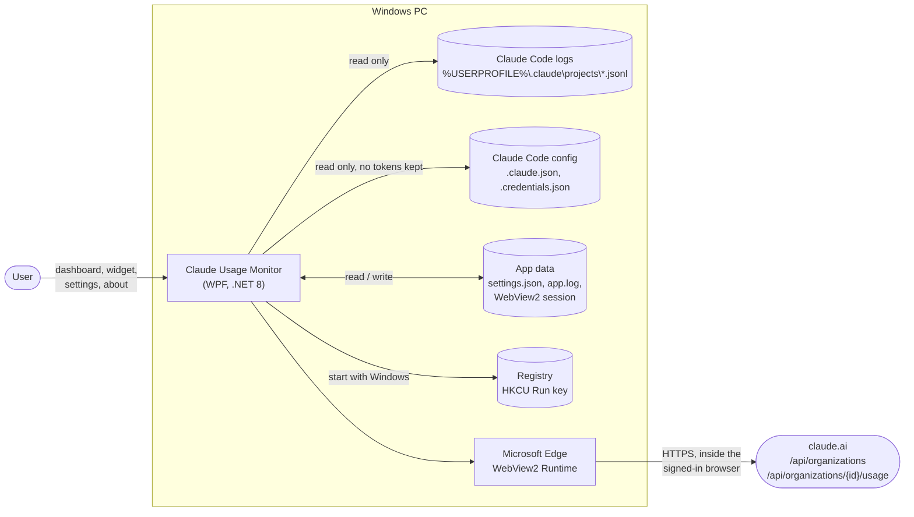
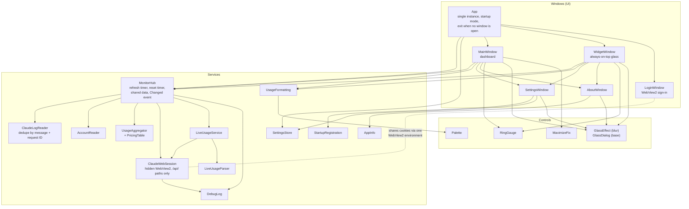
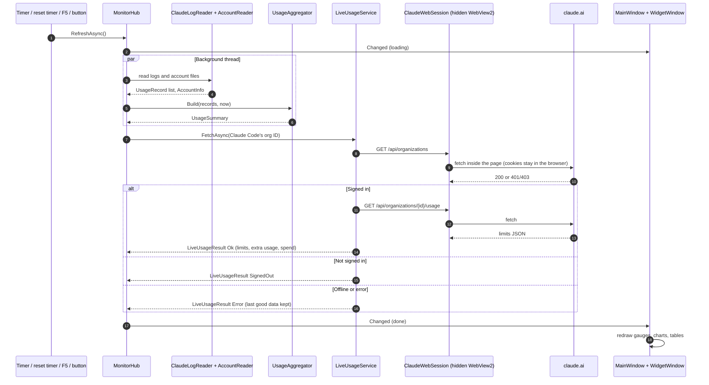
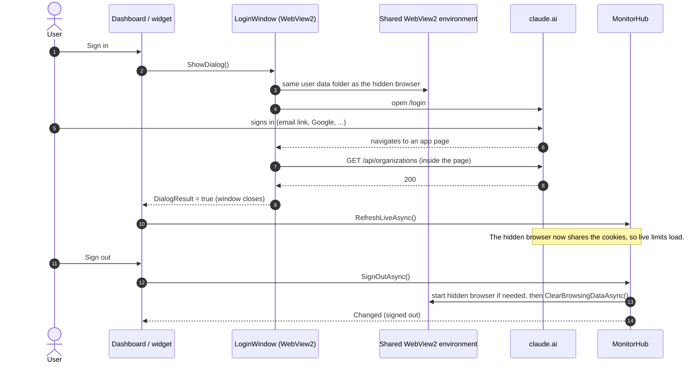
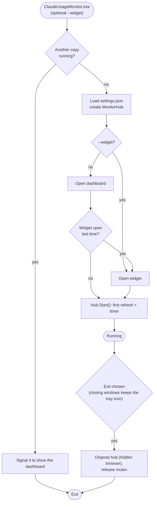
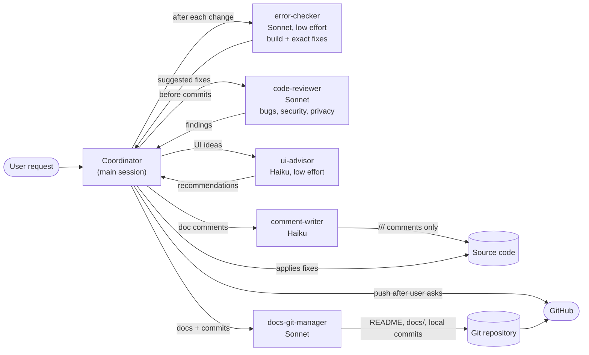

# Architecture diagrams

GitHub draws these Mermaid diagrams directly. In VS Code, use a Markdown preview with Mermaid support.

## 1. System context

What the app talks to, and what stays on the machine.

## 2. Components

How the code is split. Arrows point from the caller to what it uses.

## 3. Refresh cycle

One refresh feeds every open window. It runs on the timer (30 s to 1 h, default 1 min), on a reset timer 5 s after a limit resets (when that comes first), on F5, or from a Refresh button.

## 4. Sign-in and sign-out

The app never reads the password or the session cookie. Both stay inside WebView2.

## 5. Startup and lifetime

Start with Windows writes `"<exe path>" --widget` (or without the switch) to `HKCU\Software\Microsoft\Windows\CurrentVersion\Run`, so at sign-in Windows takes the `--widget` path above.

## 6. Development workflow with agents

The main Claude Code session is the coordinator. It writes the code and hands checks to subagents defined in `.claude/agents/`.

